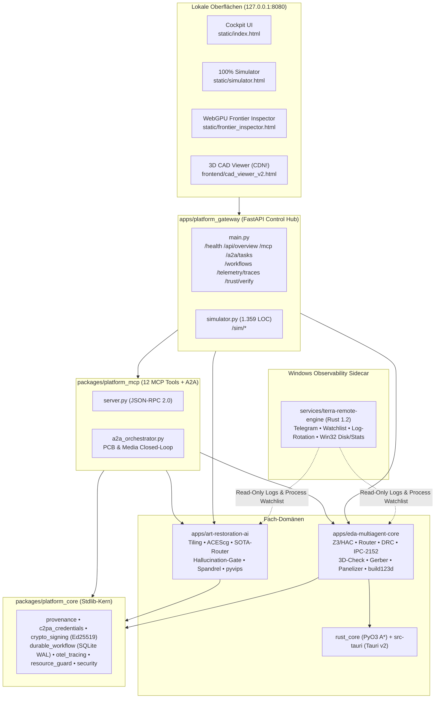
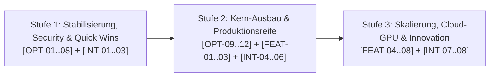

# PROJECT AUDIT & ROADMAP — Unified Deterministic Studio

> **Audit-Datum:** 2026-11-27  
> **Repository:** `https://github.com/u1092047062-dotcom/unified-deterministic-studio.git` (Lokaler Pfad: `D:\MEINE_PROJEKTE\unified-deterministic-studio`)  
> **Geprüfter Basis-Commit (`main`):** `9a3cee6653add0e54e5a82ad9574b56b716f6ad1` (Phasen 1–9 abgeschlossen, 332/332 automatisierte Tests lokal PASS)  
> **Sicherungs-Branch:** `antigravity/audit-roadmap` (**0 Quellcode-Änderungen — strikter Read-Only-Audit**)

---

## 1. Executive Summary & Projekt-Reifegrad-Scorecard

`Unified Deterministic Studio` vereint auf außergewöhnlich hohem Niveau zwei deterministische Engineering-Domänen (**Hardware/PCB-EDA** + **Quality-First Media-Restaurierung**) über einen gemeinsamen Stdlib-Kern (`packages/platform_core`), einen 12-Tool-MCP/A2A-Agenten-Layer (`packages/platform_mcp`), ein lokales FastAPI-Gateway inkl. 100%-Simulator & WebGPU-Inspektor (`apps/platform_gateway`) sowie einen nativen Rust-Windows-Sidecar (`services/terra-remote-engine`).

**Repository-Fakten (verifiziert über `git ls-files` & AST-Scan):**
- **192 getrackte Dateien** (~29.000 LOC über Python, Rust, HTML/JS, PowerShell, YAML/TOML):
  - `apps/eda-multiagent-core`: 17.052 LOC (inkl. Rust `core_fast` + `src-tauri`)
  - `apps/platform_gateway`: 2.989 LOC (Gateway, 100%-Simulator, Cockpit, Frontier-Inspektor)
  - `services/terra-remote-engine`: 2.682 LOC (Rust 1.2 Monitoring-Sidecar)
  - `apps/art-restoration-ai`: 2.583 LOC (Restaurierungs-Engine, ACEScg, SOTA-Router, Hallucination-Gate)
  - `packages/platform_core`: 2.061 LOC (Provenienz, C2PA, Ed25519, Durable WAL, OTLP, Security)
  - `packages/platform_mcp`: 863 LOC (JSON-RPC 2.0 MCP Server + A2A Closed-Loop-Agenten)
- **84 HTTP/WebSocket-Routen**, **66 Python-Quellmodule / 47 Testdateien**, **12 Rust-Dateien**, **5 HTML-Frontends**, **18 Manifest-/Config-Dateien**.

### Reifegrad-Scorecard (1–10)

| Dimension | Score | Faktenbasierte Begründung |
| :--- | :---: | :--- |
| **Architektur & Determinismus** | **9.0 / 10** | Klare Schichttrennung (`platform_core` → `eda`/`art` → `platform_mcp` → `platform_gateway`), unveränderliche `core/schema.py`, isolierte `z3.Context()`-Beweise, SQLite-WAL Durable Execution, RFC-8032 Ed25519 + C2PA. Abzug für 15× `sys.path.insert`-Workarounds & `simulator.py`-Monolith (1.359 Zeilen). |
| **Code-Qualität & Wartbarkeit** | **7.8 / 10** | 0 Clippy-Warnungen in Rust, 0 `bare except`, klare Pydantic-Modelle. Abzug für Byte-identische 645-Zeilen-HTML-Duplikate (`cad_viewer_v2.html` == `index.html`), fehlendes `conn.close()` in SQLite-Verbindungen, fehlendes `ruff`/`mypy` in CI und unaufgeräumte Test-Artefakte in `apps/art-restoration-ai/data` & `work` (357 PNGs auf Platte). |
| **Sicherheit & Zuverlässigkeit** | **7.2 / 10** | Hervorragende Basis (0 offene Secrets, Fail-Closed Toggles, `127.0.0.1`-Binding, RFC-8032 Ed25519, Pfad-Traversal-Guards). **Kritische/Hohe Lücken:** unbegrenzter RAM-Upload in `/trust/verify` & `/qc/hallucination-gate`, `"csp": null` in `src-tauri/tauri.conf.json`, fehlende HTTP-Security-Header & Rate-Limits im Gateway, ephemerer Ed25519-Key ohne persistenten Key-Store. |
| **Performance & Skalierbarkeit** | **7.5 / 10** | Exzellente 8-GB-RAM-Disziplin (`CARGO_BUILD_JOBS=2`, Streaming-I/O, Rust `core_fast` A*). Abzug für blockierende `SYNC_IN_ASYNC`-Bildverarbeitung in `qc_hallucination_gate`, fehlendes Thread-Locking im In-Memory-Simulator und ungenutzte Crates (`windows-service`, `tokio/full`) im 3,4-MB-Rust-Binary. |
| **Tests & CI/CD** | **6.8 / 10** | Lokal stark (332 Tests grün über 12 Checks in `verify_unified_platform.ps1`). **Kritischer CI-Defekt:** `.github/workflows/ci.yml` bricht auf GitHub Actions ab (`platform-core` fehlt `Pillow` & editable install; `eda`/`art` fehlt `platform_core`; `src-tauri` & Secret-Hygiene fehlen in CI). Außerdem ist `apps/art-restoration-ai/Dockerfile` im Monorepo-Kontext defekt. |
| **UX/UI & Developer Experience (DX)** | **7.0 / 10** | Starker 100%-Simulator (`/simulator`) und WebGPU-Inspektor (`/inspector`), aber Haupt-Cockpit (`index.html`) verlinkt weder `/inspector` noch `/.well-known/agent.json` noch `/mcp/tools`. Kein Root-`pyproject.toml`/`uv.lock`, fehlende `AGENTS.md`/`GEMINI.md`, veraltete `docs/UNIFIED_ARCHITECTURE.md` (Stand Phase 0). |

### Architektur- & Abhängigkeitsdiagramm

---

## 2. Detaillierte Audit-Ergebnisse (Ist-Zustand)

### Stärken (unbedingt erhalten!)
1. **Unveränderliche Single Source of Truth:** `apps/eda-multiagent-core/core/schema.py` (101 Zeilen) ist sauber entkoppelt und rückwärtskompatibel über alle 9 Phasen geblieben.
2. **Starke mathematische & kryptografische Fundamente:** Bit-exakte RFC-8032 Ed25519-Implementierung (`packages/platform_core/platform_core/crypto_signing.py`), isolierte `z3.Context()`-Elektrikbeweise (`core/hardware_as_code.py`), `< 1e-5` 32-Bit-Linear-ACEScg-Roundtrip (`restoration/color_pipeline.py`) und SQLite-WAL Durable Execution (`platform_core/durable_workflow.py`).
3. **Konsequente 8-GB-Hardware- & Secret-Disziplin:** `CARGO_TARGET_DIR` außerhalb von `C:`, `CARGO_BUILD_JOBS=2`, 0 offene Secrets über alle 192 Dateien, `cargo clippy -- -D warnings` mit 0 Warnungen.
4. **Hohe lokale Testdichte:** 332 automatisierte Tests über 8 Test-Suites in ~21 s lokal verifizierbar.

### Identifizierte Schwachstellen, Risiken & Engpässe

| Schweregrad | Befund | Beleg (Dateipfad & Zeile) | Auswirkung |
| :--- | :--- | :--- | :--- |
| **Kritisch** | **GitHub Actions CI bricht auf Remote-Runnern ab** | `.github/workflows/ci.yml:16-40` | Job `platform-core` installiert nur `pytest` (ohne `Pillow` → `test_c2pa_credentials.py` & `test_crypto_signing.py` crashen). Jobs `eda-multiagent-core` und `art-restoration-ai` installieren `packages/platform_core` nicht. `src-tauri` & Secret-Hygiene-Check fehlen in CI komplett. |
| **Kritisch** | **Defektes `Dockerfile` im Monorepo-Kontext** | `apps/art-restoration-ai/Dockerfile:1-11` | Kopiert `packages/platform_core` nicht mit ins Image, obwohl `app/main.py:16-22` `platform_core` zwingend importiert → Container startet mit `ModuleNotFoundError` nicht. |
| **Hoch** | **Unbegrenzte RAM-Uploads (OOM-/DoS-Risiko auf 8-GB-PC)** | `apps/platform_gateway/main.py:179-181` (`/trust/verify`), `apps/art-restoration-ai/app/main.py:389-400` (`/qc/hallucination-gate`), `apps/platform_gateway/simulator.py:1244-1246` (`/sim/media/upload`) | `await file.read()` lädt unbegrenzte Dateigrößen komplett in den Arbeitsspeicher ohne Chunk-Größenlimit. |
| **Hoch** | **Tauri-v2-CSP komplett deaktiviert (`csp: null`) + externes CDN** | `apps/eda-multiagent-core/src-tauri/tauri.conf.json:22`, `apps/eda-multiagent-core/frontend/cad_viewer_v2.html` | Deaktivierte Content Security Policy im Desktop-Webview; externer CDN-Abruf für Three.js widerspricht strikter Offline-/Supply-Chain-Hygiene. |
| **Hoch** | **Blockierende CPU-/Bildoperationen im Async-Event-Loop (`SYNC_IN_ASYNC`)** | `apps/art-restoration-ai/app/main.py:390-405` (`async def qc_hallucination_gate`) | `Image.open()` + NumPy Sobel/SSIM laufen synchron direkt im FastAPI-Event-Loop und blockieren parallele Requests. |
| **Hoch** | **Fehlende HTTP-Security-Header & Rate-Limiting am Gateway** | `apps/platform_gateway/main.py:1-206` | Keine `X-Content-Type-Options`, `X-Frame-Options`, `Content-Security-Policy` Middleware; rechenintensive Endpunkte (`/a2a/tasks`, `/eda/design/synthesize`, `/trust/verify`) ohne Rate-Limit. |
| **Mittel** | **SQLite-Connections werden unter Windows nicht explizit geschlossen** | `packages/platform_core/platform_core/durable_workflow.py:42-46` | `with self._connect() as conn:` committet zwar Transaktionen, ruft aber in Python `sqlite3` kein `conn.close()` auf (`contextlib.closing` fehlt) → potenzieller Windows-File-Lock-Stau. |
| **Mittel** | **15× `sys.path.insert`-Workarounds & harter Staging-Venv-Pfad** | 15 `.py`-Dateien (u. a. `apps/platform_gateway/main.py:23-31`, `apps/eda-multiagent-core/server/server.py:11-13`), `scripts/verify_unified_platform.ps1:68` | Fragile Import-Auflösung statt einheitlichem Root-Workspace (`uv.lock` / `pyproject.toml`); `verify_unified_platform.ps1` greift auf externen Staging-Pfad zurück. |
| **Mittel** | **Ephemerer Ed25519-Schlüssel statt persistentem Studio-Keystore** | `packages/platform_mcp/platform_mcp/a2a_orchestrator.py:173`, `apps/platform_gateway/simulator.py:657` | Jeder A2A-Lauf erzeugt einen neuen Einweg-Schlüssel (nicht gegen eine vertrauenswürdige Studio-Identität pinbar); Simulator & ART `/projects/{id}/c2pa/embed` nutzen noch unsignierte C2PA-Chunks statt Ed25519. |
| **Mittel** | **Byte-identische 645-Zeilen-Duplikate & 1.359-Zeilen-Simulator-Monolith** | `apps/eda-multiagent-core/frontend/cad_viewer_v2.html` == `index.html` (`SHA-256: a0cd8e135326`), `apps/platform_gateway/simulator.py` (1.359 LOC) | Doppelte Pflege beim 3D-Viewer; hohe Kopplung in `simulator.py` + fehlendes `threading.Lock` für `SIMULATOR.sessions` / `eda_runs`. |
| **Mittel** | **Test-Suite hinterlässt 357 verwaiste PNGs/JSONs auf Platte** | `apps/art-restoration-ai/data` (178 PNGs), `apps/art-restoration-ai/work` (179 PNGs) | Tests schreiben in Standard-`DATA_DIR`/`WORK_DIR` statt isoliert in `tmp_path`. |
| **Mittel** | **Ungenutzte Dependencies & Bloat in Rust/Python-Manifesten** | `services/terra-remote-engine/Cargo.toml:7,12` (`windows-service`, `tokio/full`), `apps/eda-multiagent-core/requirements.txt:6` (`langchain-openai`), `apps/art-restoration-ai/pyproject.toml:21` (`pytest>=8,<9`) | Längere Compile-Zeiten & größeres Binary (3,4 MB), ungenutzte Pakete, Version-Range-Drift gegenüber lokalem Python 3.15 / pytest 9.2. |
| **Niedrig** | **Cockpit-Navigation, Doku-Drift & fehlende `AGENTS.md` / `// SAFETY:`** | `apps/platform_gateway/static/index.html`, `docs/UNIFIED_ARCHITECTURE.md` (21 Zeilen), `services/terra-remote-engine/src/services/win32_system.rs` (16× `unsafe` ohne `// SAFETY:`-Kommentar) | `/inspector`, `/.well-known/agent.json` & `/mcp/tools` sind vom Haupt-Cockpit nicht verlinkt; Architektur-Doku deckt Phasen 1–9 nicht ab. |

---

## 3. Katalog: Optimierungen & Verbesserungen (`[OPT-01]` – `[OPT-12]`)

| ID | Kategorie | Titel | Betroffene Dateien | Aufwand | Impact | Risiko |
| :--- | :--- | :--- | :--- | :---: | :---: | :---: |
| **`[OPT-01]`** | Kritischer Fix | **GitHub Actions CI reparieren & härten** (`Pillow`, `-e platform_core`, `src-tauri`, Secret-Hygiene, `ruff`) | `.github/workflows/ci.yml` | S | Sehr Hoch | Niedrig |
| **`[OPT-02]`** | Kritischer Fix | **Monorepo-Dockerfile reparieren + `HEALTHCHECK`** (Multi-Stage-Build ab Repo-Root inkl. `platform_core`) | `apps/art-restoration-ai/Dockerfile`, (optional Root `Dockerfile`) | S | Hoch | Niedrig |
| **`[OPT-03]`** | Sicherheits-Fix | **Streaming-Upload-Limits & Async-Entkopplung** (Chunk-Limit für `/trust/verify`, `/qc/hallucination-gate`, `/sim/media/upload` + `run_in_threadpool`) | `apps/platform_gateway/main.py`, `simulator.py`, `apps/art-restoration-ai/app/main.py` | S | Sehr Hoch | Niedrig |
| **`[OPT-04]`** | Sicherheits-Fix | **HTTP-Security-Header-Middleware & Tauri-CSP härten** (`nosniff`, `DENY`, explizite Tauri-CSP statt `null`, `.innerHTML` → DOM/Text wo möglich) | `apps/platform_gateway/main.py`, `apps/eda-multiagent-core/src-tauri/tauri.conf.json`, `simulator.html` | S | Hoch | Mittel |
| **`[OPT-05]`** | Stabilitäts-Fix | **Explizites `contextlib.closing()` für SQLite-WAL-Verbindungen** (verhindert Windows-File-Lock-Leaks) | `packages/platform_core/platform_core/durable_workflow.py`, `core/part_library.py` | XS | Mittel | Niedrig |
| **`[OPT-06]`** | Test-Hygiene | **ART-Tests strikt auf `tmp_path` isolieren** (0 verwaiste Dateien in `apps/art-restoration-ai/data` & `work`) | `apps/art-restoration-ai/tests/test_api.py`, `test_checkpoints_and_provenance.py` | S | Mittel | Niedrig |
| **`[OPT-07]`** | Quick Win UX | **Cockpit UI (`index.html`) auf Phasen 1–9 aktualisieren** (Direkt-Karten für `/inspector`, `/.well-known/agent.json`, `/mcp/tools`, `/workflows`) | `apps/platform_gateway/static/index.html` | XS | Hoch | Niedrig |
| **`[OPT-08]`** | Quick Win DX | **`AGENTS.md` & aktuelle `docs/UNIFIED_ARCHITECTURE.md` erstellen** (Invarianten, Schema-Schutz, 8-GB-Guardrails, Phasen 1–9) | `AGENTS.md`, `docs/UNIFIED_ARCHITECTURE.md` | S | Hoch | Niedrig |
| **`[OPT-09]`** | Architektur | **Frontend-Duplikat auflösen & Three.js lokal vendoren** (`cad_viewer_v2.html` == `index.html` deduplizieren; 100 % offline-fähig ohne CDN) | `apps/eda-multiagent-core/frontend/`, `server/server.py` | M | Hoch | Mittel |
| **`[OPT-10]`** | Architektur | **Monorepo-Packaging mit Root-`pyproject.toml` (`uv`-Workspace)** (beseitigt 15× `sys.path.insert` & externen Staging-Venv-Pfad; `pytest>=8,<10`) | Root `pyproject.toml`, `apps/*/pyproject.toml`, `scripts/verify_unified_platform.ps1` | M | Sehr Hoch | Mittel |
| **`[OPT-11]`** | Architektur | **`simulator.py` (1.359 LOC) modularisieren & Thread-safe machen** (Aufteilen in `sim_media.py`, `sim_eda.py`, `sim_telegram.py` + `threading.RLock`) | `apps/platform_gateway/simulator.py` | M | Mittel | Mittel |
| **`[OPT-12]`** | Rust-Hardening | **Rust-Sidecar verschlanken & `unsafe` dokumentieren** (`windows-service` entfernen oder als Feature gaten, `tokio` selektiv, `// SAFETY:` + `clippy::undocumented_unsafe_blocks`, `python_api.rs` ohne `.unwrap()`) | `services/terra-remote-engine/Cargo.toml`, `win32_system.rs`, `rust_core/src/python_api.rs` | M | Mittel | Niedrig |

---

## 4. Katalog: Verifizierte Externe & Interne Integrationen (`[INT-01]` – `[INT-09]`)

Alle Quellen wurden am **2026-11-27** auf aktuelle Versionen, Lizenzen und Stack-Kompatibilität geprüft:

| ID | Ressource / Projekt | Verifizierte Quelle & Version | Lizenz | Risiko / Reifegrad | Integrations-Strategie & Build-vs.-Integrate |
| :--- | :--- | :--- | :--- | :--- | :--- |
| **`[INT-01]`** | **Astral `uv` (Workspace + `uv.lock` + `uv audit`)** | `https://github.com/astral-sh/uv` (2025/2026 Standard) | MIT / Apache-2.0 | Sehr hoch / Aktiv | **Integrate:** Ersetzt `pip` + 15× `sys.path.insert` + losen Staging-Venv durch deterministischen Cargo-ähnlichen Python-Workspace + eingebautes CVE-Auditing (`uv audit`). |
| **`[INT-02]`** | **Astral `ruff` + `ty` (oder `mypy`)** | `https://github.com/astral-sh/ruff` & `ty` | MIT | Sehr hoch / Aktiv | **Integrate:** 100× schnelleres Linting/Formatting + statische Typprüfung in `verify_unified_platform.ps1` & `ci.yml` — fängt Schema-/Key-Fehler vor dem Testlauf ab. |
| **`[INT-03]`** | **`cargo-audit` + `gitleaks`** | `https://github.com/rustsec/rustsec` / `https://github.com/gitleaks/gitleaks` | Apache-2.0 / MIT | Sehr hoch / Standard | **Integrate:** Ergänzt den eigenen Regex-Secret-Check in `verify_unified_platform.ps1` um Git-History-Secret-Scan (`gitleaks`) und RustSec-CVE-Prüfung auf alle 3 `Cargo.lock`-Dateien. |
| **`[INT-04]`** | **`slowapi` (FastAPI Rate-Limiting)** | PyPI `slowapi` (auf `limits`) | MIT | Hoch / Bewährt | **Integrate (Optional-Dep):** Schützt teure Endpoints (`/a2a/tasks`, `/eda/design/synthesize`, `/trust/verify`) gegen versehentliche Endlosschleifen oder lokale Überlastung. |
| **`[INT-05]`** | **`c2pa-python` (`0.38–0.39.x`) / `c2pa-rs` (`0.91.x+`)** | PyPI `c2pa-python` / crates.io `c2pa` | MIT / Apache-2.0 | Hoch / offizielles SDK | **Adapter (Optional-Extra `[trust]`):** Erweitert unsere reine PNG-`iTXt`-Ed25519-Engine um voll standardkonforme JUMBF-C2PA-Boxen (JPEG, PNG, MP4, WebP) inkl. X.509-Zertifikatsketten. |
| **`[INT-06]`** | **`pygerber` (`2.4.3`)** | PyPI `pygerber` (`2.4.3`) | MIT | Hoch / Stabil | **Adapter (bereits vorbereitet in `gerber_verifier.py`):** Liefert vollwertige Gerber-X2/X3-Syntaxprüfung und hochauflösende Raster-/SVG-Renderings für komplexe Kunden-Boards. |
| **`[INT-07]`** | **`spandrel` (`0.4.x+`) + `PyOpenColorIO` (`2.6.0`)** | PyPI `spandrel` / `opencolorio` (`2.6.0`) | MIT / BSD-3-Clause | Sehr hoch / Industriestandard | **Cloud-GPU-Extra (`[gpu]`):** `spandrel` lädt 40+ SOTA-Restaurierungsarchitekturen (HAT, NAFNet, SwinIR, Real-ESRGAN) über unseren bestehenden Fail-Closed-SHA-256-Adapter; `PyOpenColorIO` ergänzt ACES-2.0-LUTs. |
| **`[INT-08]`** | **`kicad-python` (`0.8.x`) — LIZENZ-HINWEIS!** | PyPI `kicad-python` | **GPL-3.0-or-later** | Hoch / Offiziell KiCad 9+ | **Prozess-isolierter Sidecar / Opt-In-Extra!** Wegen **GPL-3.0** niemals statisch in proprietäre/MIT-Kernpakete einbinden — nur als separater optionaler Adapterprozess über unsere `kicad9_ipc.py`-Brücke. |
| **`[INT-09]`** | **Interne Referenz-Ressourcen (`05_PLATINEN_ELEKTRONIK` & `Topaz`)** | Lokaler Bestand (`D:\MEINE_PROJEKTE\.PMM_STAGING_...`, `C:\Users\host28\Desktop\211126 topaz\Topaz`) | Eigener Bestand | Verifiziert | Bereits vollständig nach `unified-deterministic-studio` migriert; alte Verzeichnisse bleiben strikt Read-Only als historisches Backup. |

---

## 5. Katalog: Weiterer Entwicklungsfahrplan & Erweiterungen (`[FEAT-01]` – `[FEAT-08]`)

### Kategorie A — Kern-Erweiterungen (Must-Have)
- **`[FEAT-01]` Persistenter lokaler Studio-Signing-Keystore (Windows DPAPI / Ed25519 Key-Rotation):** Ersetzt ephemere Einweg-Keys in A2A, Simulator & ART `/projects/{id}/c2pa/embed` durch eine stabile, maschinenlokale Studio-Identität (mit Public-Key-Export unter `GET /trust/public-key` & Key-Revocation-Liste).
- **`[FEAT-02]` End-to-End Ed25519-Signierung in Simulator & ART-Pipeline:** Verdrahtet `embed_signed_png_c2pa()` direkt in `apps/platform_gateway/simulator.py` und `apps/art-restoration-ai/app/main.py` (`/projects/{id}/c2pa/embed`), inkl. Prüf-Badge im Simulator & Inspektor.
- **`[FEAT-03]` Echte `Hallucination-Delta-Gate`-Heatmap-Visualisierung im Frontier-Inspektor (`/inspector`):** Upload/Vergleich von Original + Restauriert direkt im Browser mit Live-False-Color-Heatmap (`render_delta_heatmap_png`) + SSIM/PSNR/Kanten-Drift-Ampel.

### Kategorie B — High-Value-Features (Produktionsniveau)
- **`[FEAT-04]` Offline Rust→WASM C2PA- & Ed25519-Client-Verifier:** Kompiliert einen kompakten Rust-Verifier nach WebAssembly (Zero-Upload-Prüfung direkt im Browser in `/inspector`).
- **`[FEAT-05]` Live-RunPod-Spot-GPU-Worker-Adapter (Opt-In, hinter Durable WAL + Kosten-Circuit-Breaker):** Verbindet `DurableWorkflowEngine` real mit einem optionalen Cloud-GPU-Worker (z. B. `SeedVR2` / `HAT-L` via `spandrel`), bleibt aber per Default strikt `RUNPOD_ENABLED=false`.
- **`[FEAT-06]` Prometheus `/metrics` & OTLP/HTTP-Push-Exporter:** Ergänzt `otel_tracing.py` um optionalen echten OTLP-Export bei gesetzter `OTEL_EXPORTER_OTLP_ENDPOINT` sowie Prometheus-Metriken für EDA-/ART-Laufzeiten und DRC-/Hallucination-Raten.

### Kategorie C — Zukunftsweisende / Innovative Erweiterungen
- **`[FEAT-07]` Datenblatt-PDF-zu-HAC-Extraktor (mit verpflichtendem Z3-Beweis-Gate):** Liest strukturierte Pin-Tabellen aus MCU-/Sensor-Datenblättern ein, erzeugt deklarativen `.hac`-Code und lässt Z3 alle Spannungs-/Strom-Constraints beweisen, bevor das Routing startet.
- **`[FEAT-08]` GPU-beschleunigtes Multi-Layer-Autorouting (`wgpu` Compute Shader in `rust_core`):** Erweitert `apps/eda-multiagent-core/rust_core` um optionales `wgpu`-Feature für paralleles 3D-Manhattan-Routing großer Boards.

### Impact-vs.-Effort-Matrix & 3-Stufen-Roadmap

| Stufe | Arbeitspakete | Zielzustand |
| :--- | :--- | :--- |
| **Stufe 1 — Stabilisierung, Sicherheit & Quick Wins** | `[OPT-01]`–`[OPT-08]`, `[INT-01]`–`[INT-03]` | 100 % grüne GitHub Actions CI, funktionierendes Monorepo-Dockerfile, OOM-sichere Uploads, Tauri-CSP & HTTP-Security-Header, saubere `tmp_path`-Tests, aktualisiertes Cockpit & `AGENTS.md`. |
| **Stufe 2 — Kern-Ausbau & Effizienz-Integrationen** | `[OPT-09]`–`[OPT-12]`, `[FEAT-01]`–`[FEAT-03]`, `[INT-04]`–`[INT-06]` | `uv`-Workspace ohne `sys.path`-Hacks, 100 % offline Three.js ohne Duplikat, persistenter Ed25519-Keystore in allen Pipelines, Live-Heatmap im `/inspector`, modularer Thread-sicherer Simulator, verschlankter Rust-Sidecar. |
| **Stufe 3 — Skalierung, Automatisierung & Innovation** | `[FEAT-04]`–`[FEAT-08]`, `[INT-07]`–`[INT-08]` | WASM-Browser-Verifier, optionaler Cloud-GPU-Worker (`SeedVR2`/`spandrel`), OTLP/Prometheus-Observability, Datenblatt→HAC→Z3-Pipeline, optionales `wgpu`-Routing. |

---

## 6. Konkrete Entscheidungsoptionen für unseren nächsten Schritt

### Vorgeschlagene Umsetzungspakete
1. **Paket 1 — „Stabilität, CI & Security First“ (Empfohlener Sofort-Start):**  
   `[OPT-01]`, `[OPT-02]`, `[OPT-03]`, `[OPT-04]`, `[OPT-05]`, `[OPT-06]`, `[OPT-07]`, `[OPT-08]`  
   *Ergebnis:* Schließt alle kritischen und hohen Audit-Befunde (CI, Dockerfile, Upload-OOM, Tauri-CSP, Security-Header, SQLite-Close, Test-Müll, Cockpit-Links, `AGENTS.md`) bei minimalem Risiko.
2. **Paket 2 — „Ausgewogener Produktions-Ausbau“ (Paket 1 + Kern-Architektur):**  
   Paket 1 **plus** `[OPT-09]`, `[OPT-10]`, `[OPT-11]`, `[OPT-12]`, `[FEAT-01]`, `[FEAT-02]`, `[FEAT-03]`, `[INT-01]`, `[INT-02]`  
   *Ergebnis:* Hebt Packaging (`uv`), Offline-Frontend, persistenten Ed25519-Keystore, Live-Heatmap-Inspektor und Rust-Hardening auf echtes Release-Niveau.
3. **Paket 3 — „Maximaler Innovations- & Skalierungssprung“ (Stufen 1–3 komplett):**  
   Paket 2 **plus** `[FEAT-04]`, `[FEAT-05]`, `[FEAT-06]`, `[FEAT-07]`, `[FEAT-08]`  
   *Ergebnis:* Vollständige Frontier-Suite inkl. WASM-Verifier, Cloud-GPU-Spot-Worker-Bridge, Prometheus/OTLP-Push und Datenblatt→HAC→Z3.

### Freie Einzelauswahl (Checkliste aller IDs)
- **Optimierungen:** `[OPT-01]` `[OPT-02]` `[OPT-03]` `[OPT-04]` `[OPT-05]` `[OPT-06]` `[OPT-07]` `[OPT-08]` `[OPT-09]` `[OPT-10]` `[OPT-11]` `[OPT-12]`
- **Integrationen:** `[INT-01]` `[INT-02]` `[INT-03]` `[INT-04]` `[INT-05]` `[INT-06]` `[INT-07]` `[INT-08]` `[INT-09]`
- **Erweiterungen:** `[FEAT-01]` `[FEAT-02]` `[FEAT-03]` `[FEAT-04]` `[FEAT-05]` `[FEAT-06]` `[FEAT-07]` `[FEAT-08]`
